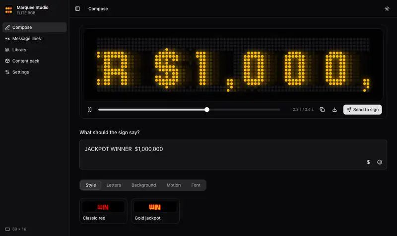

# Umami Marquee Studio

Software for a Mikohn casino LED marquee sign that its maker no longer supports. The firmware is rebuilt from
source and checked against the original in a simulator of the board, and Umami Marquee Studio replaces the lost authoring
software.



## Status

| Part | State |
|---|---|
| Firmware (ELITE_RGB V4.20) | Builds from source: 601 functions as C, the rest as assembly that reassembles byte-identical, and the data read from your own dump. In the simulator it behaves like the stock firmware through start-up, normal and attract display, RS-485 jackpot records, the DB9 port and the remote-control menu, and saving a setting leaves NVRAM byte-identical. It has not run on the sign yet. |
| Boot flash image | `make -C bootloader fwimage` builds a complete 512 KB image for the socketed AM29LV040B: the original boot loader and content, the from-source app NRV2D-packed, with native emoji (`NATIVE_EMOJI=0` for the plain stock-equivalent app). `make -C bootloader fwtest` boots it in the simulator. |
| Native emoji | Emoji in any message, as UTF-8, drawn in colour 1:1 from 16 px pixel art (329 emoji packed into 15.8 KB), with any font (`docs/NATIVE-EMOJI.md`). Added to the from-source firmware as an extension; plain text draws exactly as before. Verified inside the running firmware in the simulator. |
| Boot loader | Rebuilt in C and identical to the original in co-simulation. The network variant (`NET=1`) serves the flash, NVRAM and EEPROMs over TFTP and can boot an app from RAM. |
| Umami Marquee Studio | The authoring tool. You write a message with any of the sign's animations, fonts and emoji, see it on a live LED preview, send it over RS-485 or build a content pack. |
| Marquee Portal | Planned (`docs/PORTAL-PLAN.md`): a self-hosted messaging site on a Raspberry Pi 5 that drives the sign. |

## Quick start

```sh
./check.sh                       # every check (decompile, claims, boot loader, studio, front end); --full adds the co-simulations
studio/run.sh                    # Umami Marquee Studio at http://127.0.0.1:8750 (build the UI first: cd frontend && npm ci && npm run build)
cmake -S simulator -B build/simulator && cmake --build build/simulator   # the C++ simulator (brew install unicorn capstone sdl3 webp)
build/simulator/umami-marquee-sim      # the simulated sign with its debugger and the Studio, gdb on :1234 (docs/SIMULATOR-GUI.md)
```

The animation above is recorded by `cd frontend && npm run readme-demo`. It builds the UI, starts Studio on a
throwaway content folder made from the vendored free fonts and emoji and from animations drawn in code
(`studio/demo_content.py`), plays a scripted session in headless Chromium, and writes `docs/media/studio-demo.webp`.
Nothing in it comes from the sign, and sending to a serial port is blocked during the recording.

The firmware builds from source and reads no dump. It needs one local file that stays out of git, the panel FPGA's
bitstream (`tools/extract_fpga_bits.py`). The result is `bootloader/build-dump/bootflash-fw.bin`, which the Sign window installs:

```sh
make -C bootloader DUMP=1 fwimage PYTHON=../venv/bin/python
tools/fw_check.sh --no-dump   # the same build with dumps/ and analysis/ unreadable, then the checks in the simulator
```

To program a chip, follow `docs/FLASHING.md`: a spare chip only, the patched minipro, and a voltage check first.

## Repository

| Path | What |
|---|---|
| `analysis/` | The firmware's address map (`symbols.tsv`, the source of truth for names, types and stack structs), Ghidra scripts, and the tools that check the decompiled C against the firmware and build it: `compile_check`, `difftest`, claims, `rebuild.py`, `asmsrc.py`, `fwbuild.py`. Notes in `ANALYSIS.md`, RS-485 in `PROTOCOL-RS485.md`. |
| `bootloader/` | BOOTSTRAP V2.00 in C, the network boot loader (lwIP), the colour-emoji patch, the NRV2D compressor and the boot-flash image builder. See `bootloader/README.md`. |
| `firmware/app/` | The firmware's core: main loop, hardware layer, serial, delivery, and the text engine (`engine/`, a port of `frontend/packages/sign-emu`). |
| `firmware/ext/` | The apps, content store, console, updates, crash reports, fonts and native emoji. |
| `sim/` | The system simulator (`appsim.py`: CPU, interrupts, timer, CPM UARTs, IDMA panel output, I²C EEPROMs, the IR remote) the comparisons against the stock image (`compare.py`, `compare_rs485.py`, `compare_db9.py`, `compare_menu.py`, `flashtest.py`, `find_culprit.py`, `test_native_emoji.py`, `test_console.py`). |
| `simulator/` | The simulator in C++ (the same board model, about 2 to 3 times faster than `sim/`, checked identical to it) with its debugger: a Dear ImGui window with the live panel, disassembly, registers, memory, breakpoints, RTEMS tasks, the serial ports and the remote, and a GDB server for VS Code; and Umami Marquee Studio in C++ (Compose, Lines, Library, Pack, Settings, Send), previewed by the firmware running in the simulator (`docs/SIMULATOR-GUI.md`). |
| `studio/` | Umami Marquee Studio's Python package (`marquee_studio`: rendering, fonts, effects, markup, LFS, sign protocols) and Flask API. See `studio/README.md`. |
| `frontend/` | The Studio UI: React, Vite and TypeScript with vendored shadcn/ui components. |
| `emulator/` | The original panel emulator (RGB555 panel, FLIC decoder, font renderer). |
| `docs/` | Flashing, the rebuild plan, verification, the simulator and its debugger, menu, effects, message markup, controller messages, FPGA, network stacks, the portal plan, ideas, the backlog and the investigation log. |
| `tools/` | Probes, dump scripts, the protocol CLI and the minipro patch (`tools/minipro/`). |
| `third_party/` | Vendored sources (RTEMS 4.6.0, newlib 1.11.0, zlib 1.1.4, libpng 1.2.5, lwIP) and permissively licensed fonts and emoji. See `THIRD-PARTY.md`. |
| `SPEC.md` | The reconstruction reference: panel model, file formats, message model, protocols. |

## The hardware

The controller is a Neurizon Pty Ltd "LED Display Processor, Series 2" (CPU-002 Rev 2.6), and the sign shows an
animated MIKOHN logo at boot. It runs RTEMS 4.6 on a Motorola XPC862P, a big-endian PowerPC.

- Memory: 128 MB SDRAM (4x K4S561632E), 32 MB of main flash (2x AM29LV128MH, TSOP-56) holding the LFS content
  volumes, and 32 KB of battery-backed NVRAM for settings, attract lines and jackpot records.
- Boot flash: a socketed AM29LV040B (512 KB, 3.3 V, PLCC32) with the boot loader, the NRV2D-compressed ELITE_RGB
  app and the built-in content (logo, 20 effect animations, 8 fonts).
- Other parts: a Xilinx Spartan FPGA, which the app configures and which scans the LEDs; an LXT972A Ethernet PHY;
  an ADM211 RS-232 transceiver; a DS1306 RTC that V4.20 never uses; an LTC695 supervisor; and a coin cell for the
  NVRAM.
- Ports: a DB9 labelled "RS232 DTE MODEM", two RS-485 ports on RJ45, Ethernet, a 2x8 debug header, the IR remote
  receiver, and jumpers JP2 SW1/SW2.

## What is known

- The CPU draws every LED frame itself in RGB555 and sends it by DMA (IDMA) to the FPGA, which only scans the LEDs.
  The panel size comes from the config EEPROM. This sign is 200x16, E-series (EEPROM word 0xC240, "ED0501"): five boards of 5 x 2 RGB modules
  of 8x8 LEDs, counted on the sign. 80x16 is the firmware's fallback and the size the first content was made for.
- Content arrives over RS-485, where the sign is a slave on a casino jackpot bus. The firmware has 12 selectable
  protocols, among them Cougar, Translux, TGSNCP, Mikohn CON2 and WMS. Cougar frames are DLE-framed with a
  CRC-16/CCITT, and address 1 carries 69-byte jackpot/text records, which the sign shows only for levels it has
  mapped (`analysis/PROTOCOL-RS485.md`).
- The DB9 port is a .lfs download server (115200 8N1, sync 0x5A from the host and 0xA5 from the sign,
  CRC-16/XMODEM). A complete transfer writes the main flash.
- The stock firmware never uses Ethernet. The network boot loader in `bootloader/` does.
- Animations are Autodesk FLIC (.flc) files, fonts are PNG glyph atlases and sounds are WAV, all packed in LFS
  archives (stored, zlib, bzip2 or NRV2D). Settings live in NVRAM as named blocks.
- The on-screen menu is driven by the IR remote, and a PIN sets the access level (`docs/MENU.md`).

`docs/INVESTIGATION-LOG.md` records how the sign was probed before the boot flash was dumped.

## Safety rules

- Never send a valid DB9 transfer sequence (frame types 0x20, 0x21 and 0x10 in order), because it writes the main
  flash. The tools only send read-only probes.
- Never use stock minipro with a TL866A on the 3.3 V boot flash: it supplies 5 V. Use the patched build
  (`tools/minipro/`) or a T48/TL866II+.
- Program only a spare AM29LV040B and keep the original chip. Nothing in this repository writes the main flash.

## Tools (`tools/`)

Serial and protocol tools need only the Python standard library; the Saleae scripts need `logic2-automation`.

| Script | Purpose |
|---|---|
| `signproto.py` | Sign protocols (DB9 and RS-485 frames); read-only probes: `whoami`, `listen`, `selftest`. |
| `signserial.py` | Serial tool: `listen BAUD [SECS]`, `scan`, `modem BAUD`, `blind SECS [BAUD...]`, `reply SECS [BODYHEX]`. Logs to `captures/serial/`. |
| `dump_bootflash.sh` | Reads the boot flash twice with minipro and compares; writes `dumps/bootflash.bin`. Read-only. |
| `tl866_voltcheck.py` | Measures the programmer's VCC on the adapter with a Saleae before a chip goes in. |
| `extract_bootflash.py` | Walks the boot-flash archive and unpacks its entries. |
| `nvram_decode.py` | Decodes an NVRAM dump (settings blocks, attract lines, jackpot records). |
| `serdump.py` | Receives a flash/NVRAM dump over the DB9 from the serial-dump boot loader. |
| `gif2flc.py`, `lfs.py`, `mkpatch.py` | GIF to FLC, LFS packing, the PATCH archive entry. |
| `saleae_capture.py`, `voltcheck.py`, `rs485_survey.py` | Saleae capture and decode, DC check, RJ45 RS-485 pin survey. |
| `sign-capture.sh`, `sign-arpsweep.sh` | Ethernet capture during a sign boot and an ARP sweep of the private ranges. Run with sudo; take the interface as an argument. |
| `cmdscan.py`, `crcfind.py`, `experiments.py` | Early DB9 command scans and CRC identification. |

## Licence and contents

This is independent interoperability and repair research on a sign the author owns. It is not affiliated with,
endorsed by or connected to Mikohn Gaming, Progressive Gaming International, IGT or Neurizon Pty Ltd. Product and
company names are used only to identify the hardware.

The repository holds source code and documentation written for this project: the tools, the studio and its front
end, the emulator, the simulator, the analysis scripts, the symbol map (`analysis/symbols.tsv`), the notes and the C
rebuild of the boot loader. That code is under the MIT licence (`LICENSE`).

`third_party/` holds copies of lwIP (BSD, compiled into the network boot loader), RTEMS 4.6.0 (GPL v2 with a
linking exception), and newlib 1.11.0, zlib 1.1.4 and libpng 1.2.5, which the analysis reads to identify library
functions. It also holds fonts and emoji under permissive licences. `THIRD-PARTY.md` lists each with its version,
its licence and what that licence asks of us.

There is no firmware here, no flash dump, no decompiler or disassembler output, and no font, animation, sound or
logo taken from the sign. Anything that needs the firmware reads it at build time from a dump you make of your own
hardware. The sign's hard-coded master menu code is redacted.
- `.gitignore` is an allow-list (text sources and docs; vendored fonts are the only binaries).
  `tools/check_no_binaries.sh` runs as the pre-commit hook
  (`printf '#!/bin/sh\nexec tools/check_no_binaries.sh\n' > .git/hooks/pre-commit`) and refuses binaries,
  files over 1 MB and the redacted code; the redacted strings live in `.git/info/redact-patterns`, never committed.
